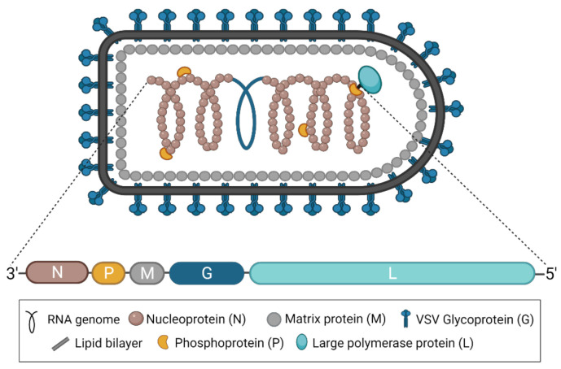

# Vesicular Stomatitis Virus (VSV)

`vsv` builds a recombinant VSV vaccine plan from a pathogen genome and the Indiana chassis. Mark the glycoprotein, place it by a method the literature states, and read which published vaccines used that same arrangement.

<p align="center">
  
</p>
<p align="center">
  <em>Liu G, Cao W, Salawudeen A, et al. Vesicular Stomatitis Virus: From Agricultural Pathogen to Vaccine Vector. Pathogens. 2021;10(9):1092. Published 2021 Aug 27. doi:<a href="https://doi.org/10.3390/pathogens10091092">10.3390/pathogens10091092</a></em>
</p>

## Develop a vaccine

```python
import vsv
from vsv import AntigenClass, Gene, Replication

virus = vsv.read_record("outbreak.gb")  # FASTA, GenBank, or SBOL3
glycoprotein = virus.mark(virus.cds("GP"), AntigenClass.filovirus_glycoprotein)

chassis = vsv.indiana()
vaccine = chassis.replace(
    chassis.feature(Gene.GLYCOPROTEIN),
    glycoprotein,
    replication=Replication.COMPETENT,
    identifier="rvsv_dg_outbreak_gp",
    name="rVSV outbreak glycoprotein",
)

vaccine.check()  # true when the plan passes

for published in vaccine.precedents(vsv.plans()):
    for result in published.observations:
        result.phenotype, result.host, result.citation, result.note
```

`read_record` keeps the features in the file. `mark` writes an antigen class onto the coding feature you name. The classes the library already uses are attributes of `AntigenClass`, such as `AntigenClass.filovirus_glycoprotein`. A glycoprotein it has not named yet is `AntigenClass("paramyxovirus-glycoprotein")`.

`replace` removes VSV G and puts the marked gene in that position. Pass `Replication.COMPETENT` when the foreign protein supplies entry, and `Replication.SINGLE_CYCLE` when it does not. The plan records the gene order, the edit, and the citation for the method. The open reading frame stays on `virus`.

`check` is true when the plan passes. The failures are on `check().violations`. `precedents` returns the published plans with this same arrangement. For a replacement, that includes the filovirus, Marburg, Lassa, and SARS-CoV-2 spike plans. Each `result` is one cited outcome from those plans: phenotype, host, assay, and the paper. `vaccine.observations` is empty.

`vaccine.write` stores the plan as an SBOL3 file. Any SBOL3 reader opens that file. `vsv.read` loads it again, and `antigen` returns the feature for one antigen class:

```python
vaccine.write("rvsv_dg_outbreak_gp.ttl")
vaccine_from_file = vsv.read("rvsv_dg_outbreak_gp.ttl")
vaccine_from_file.antigen(AntigenClass.filovirus_glycoprotein).display_id  # "GP"
```

A FASTA record has no features. Give the coding sequence as a zero-based, half-open span:

```python
virus = vsv.read_record("outbreak.fasta")
glycoprotein = virus.mark(
    virus.add_cds("GP", start, end), AntigenClass("paramyxovirus-glycoprotein")
)
```

To keep VSV G, insert the gene after it. To place the gene first, insert it after the leader.

```python
vaccine = chassis.insert(
    glycoprotein,
    after=chassis.feature(Gene.GLYCOPROTEIN),
    identifier="rvsv_outbreak_gp",
    name="rVSV outbreak glycoprotein",
)
# chassis.insert(glycoprotein, after=chassis.leader, identifier=..., name=...)
```

A sequenced Indiana genome is a chassis as well: `vsv.plan(vsv.load("data/raw/NC_001560.fasta"))`. `vsv.load` names the five VSV genes in genome order. Spans are zero-based and half-open, so `genome.genes[Gene.GLYCOPROTEIN].cds_dna` is the coding sequence.

## Command line

```bash
vsv genes data/raw/NC_001560.fasta
vsv extract -g g --kind protein data/raw/NC_001560.gb
vsv designs
vsv show rvsv_dg_filovirus_gp
vsv check data/designs/vsv_indiana
```

On the command line the genes are `n`, `p`, `m`, `g`, and `l`. `vsv extract` writes gene, cds, or protein sequence. `vsv designs` lists the curated library. `vsv check` prints structural violations and knowledge gaps and exits 1 when a structural rule fails.

`data/designs/` holds one directory per published architecture: `design.ttl` and `PROVENANCE.md`. The plan stores no insert sequence. `vsv.plans()` reads that library.

`vsv ingest --all` stores the PubMed corpus under `data/corpus/`. `vsv papers --plan rvsv_dg_filovirus_gp` lists papers that mention an alias of that design. `vsv promote` writes one accepted cluster into `data/designs/`.

## Literature

- [Vesicular stomatitis virus: re-inventing the bullet](https://pubmed.ncbi.nlm.nih.gov/15121047/) - May 2004
- [Vesicular stomatitis virus (VSV) as a vaccine vector for immunization against viral infections](https://pubmed.ncbi.nlm.nih.gov/24379275/) - Jan 2013
- [Complete Genome Sequences of Two Vesicular Stomatitis Virus Isolates Collected in Mexico](https://pmc.ncbi.nlm.nih.gov/articles/PMC5597772/) - Sep 2017 ([VSV Isolate 1](https://www.ncbi.nlm.nih.gov/nuccore/MF196237), [VSV Isolate 2](https://www.ncbi.nlm.nih.gov/nuccore/MF196238))
- [Vesicular Stomatitis Virus: From Agricultural Pathogen to Vaccine Vector](https://pubmed.ncbi.nlm.nih.gov/34578125/) - Aug 2021
- [An efficient plasmid-based system for the recovery of recombinant vesicular stomatitis virus encoding foreign glycoproteins](https://www.nature.com/articles/s41598-024-65384-8) - Jun 2024
- [Leveraging Synthetic Virology for the Rapid Engineering of Vesicular Stomatitis Virus (VSV)](https://pubmed.ncbi.nlm.nih.gov/39459973/) - Oct 2024
- [Low-dose VSV-EBOV vaccination provides rapid protection from lethal Ebola virus challenge](https://pubmed.ncbi.nlm.nih.gov/41727071/) - Feb 2026

## Data

- [VSV Genome Sequence](https://www.ncbi.nlm.nih.gov/nuccore/NC_001560) - Complete genome sequence of Vesicular Stomatitis Virus (VSV)
- [VSV Protein Structures](https://www.rcsb.org/structure/6VSV) - 3D structures of VSV proteins available in the Protein Data Bank (PDB)
- [Vesicuovirus on ViralZone](https://viralzone.expasy.org/21) - Information on the Vesiculovirus genus, including VSV, on ViralZone

## Resources

- [VSV Gene Expression Vector on VectorBuilder](https://en.vectorbuilder.com/resources/vector-system/pVSV_Exp.html)
